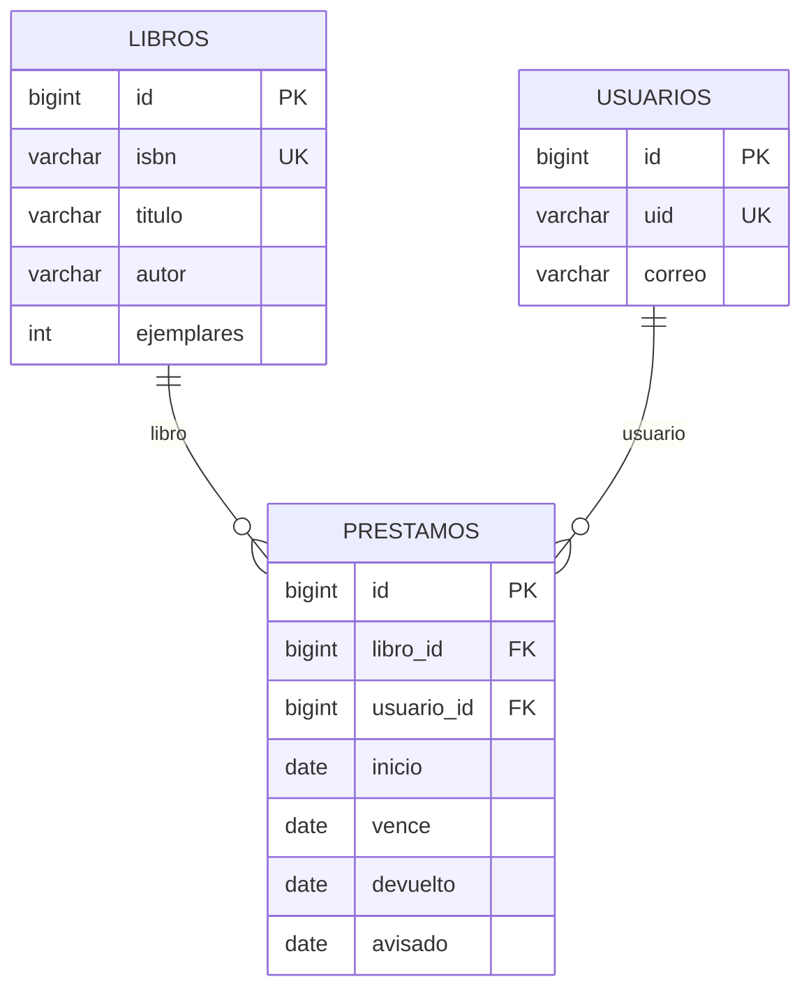

# Biblioteca universitaria XYZ

Aplicación académica con Jakarta Faces (JSF), CDI, JPA/Hibernate, JAX-RS, WildFly 35, Java 17 y MySQL 8.4.

## Ejecutar en Windows

Con Docker Desktop iniciado en modo de contenedores Linux, desde la carpeta del proyecto:

```powershell
docker compose up --build -d
docker compose logs -f web
```

Al ver el despliegue de `biblioteca.war`, abrir http://localhost:8080/biblioteca/. El correo de prueba se recibe en http://localhost:8025. Para detener los servicios y conservar los datos usar `docker compose down`.

| Cuenta LDAP de demostración | Función |
| --- | --- |
| operador | Registrar libros, prestar, recibir devoluciones y exportar reportes |
| alumno | Consultar el catálogo y sus préstamos activos |
| alumno01 a alumno10 | Estudiantes activos de demostración |
| inactivo | Comprobar el rechazo de estudiantes inactivos |

Las cuentas del directorio local usan la contraseña **DemoXYZ2026**. El formulario autentica mediante bind LDAP y el préstamo vuelve a consultar el estado del estudiante. Para un directorio institucional, configurar `LDAP_URL` con LDAPS y un certificado de confianza, `LDAP_PEOPLE`, `LDAP_BIND_DN` y `LDAP_BIND_PASSWORD`. El mapeo implementado espera entradas `uid`, `mail` y `employeeType` con los valores del archivo `infra/usuarios.ldif`. El entorno Compose utiliza cuentas, transporte y buzón de laboratorio para uso local.

## Datos para la exposición

Al ejecutar `docker compose up -d`, se cargan **12 títulos ficticios con 45 ejemplares en total** y **10 estudiantes activos** con códigos `alumno01` a `alumno10`. La carga también funciona con volúmenes existentes y conserva las filas con el mismo ISBN o código institucional. Puedes ingresar como `operador`, elegir **Programación en Java** y prestar un ejemplar a `alumno01` (Ana Torres). Luego ingresa con esa cuenta para consultar su préstamo.

## Modelo JPA



`Libro.prestamos` y `Usuario.prestamos` usan `@OneToMany(mappedBy=...)`. `Prestamo.libro` y `Prestamo.usuario` usan `@ManyToOne`. Una fila de préstamo representa un ejemplar del título. La disponibilidad se calcula restando los préstamos abiertos del total registrado. Las altas usan bloqueo de usuario y libro en una transacción. Hibernate mantiene en la caché de segundo nivel los datos de Libro. El conteo de disponibilidad consulta MySQL.

## Demostración

1. Ingresar como operador. Registrar un título con ISBN **9780134685991**, autor y cuatro ejemplares. Probar también un ISBN con el último dígito cambiado.
2. Prestar un ejemplar a **alumno** con vencimiento mañana. Una fecha pasada o la cuenta **inactivo** deben ser rechazadas. Con tres préstamos abiertos, el cuarto intento debe rechazarse incluso si queda stock.
3. Consultar `GET /biblioteca/api/libros/1/disponibilidad` con el ID real. Devuelve JSON con ISBN, título, total y disponibles. Un ID inexistente devuelve HTTP 404.
4. Ingresar como alumno y verificar los préstamos. Volver como operador y registrar una devolución. La disponibilidad debe subir una unidad.
5. Descargar el Excel. La primera hoja cuenta todos los préstamos por título, incluidas las devoluciones. La segunda cuenta por usuario los préstamos abiertos con fecha de vencimiento anterior a hoy en Lima.
6. El temporizador revisa avisos cada 15 minutos y envía al correo LDAP un recordatorio desde el día anterior al vencimiento, como máximo una vez por día en operación normal. Un fallo SMTP deja el aviso pendiente para la siguiente revisión. Revisar Mailpit.
7. Cada día a las 06:00 de Lima se genera un Excel fechado en el volumen de reportes. Para listar los archivos, usar `docker compose exec web ls /opt/jboss/wildfly/standalone/data/reportes`.

## Conciliación del reporte

Con la actividad de prueba detenida, comparar cada fila del Excel con estos conteos independientes en MySQL. Usar la fecha local del reporte en la segunda consulta.

```sql
SELECT l.isbn, COUNT(*) AS prestamos
FROM prestamos p JOIN libros l ON l.id = p.libro_id GROUP BY l.isbn;

SET @fecha_corte = DATE(UTC_TIMESTAMP() - INTERVAL 5 HOUR);
SELECT u.uid, COUNT(*) AS vencidos
FROM prestamos p JOIN usuarios u ON u.id = p.usuario_id
WHERE p.devuelto IS NULL AND p.vence < @fecha_corte GROUP BY u.uid;
```

Para cada hoja, sumar las diferencias absolutas por clave y dividirlas entre el total de referencia. El objetivo es menos de 2 %. Con un total de referencia cero se espera una hoja sin filas de datos. Para probar morosidad el mismo día, en una base de demostración con un préstamo abierto se pueden ajustar su inicio y vencimiento a fechas pasadas antes de descargar el reporte.
